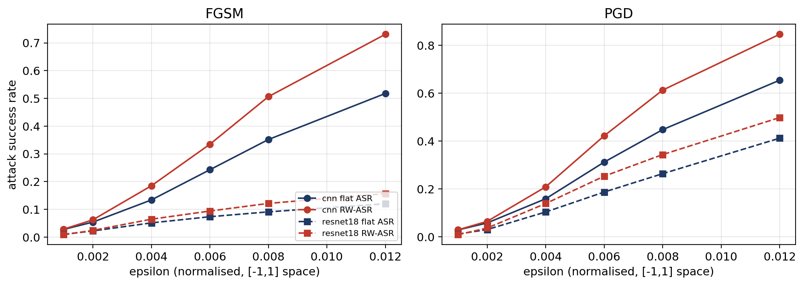
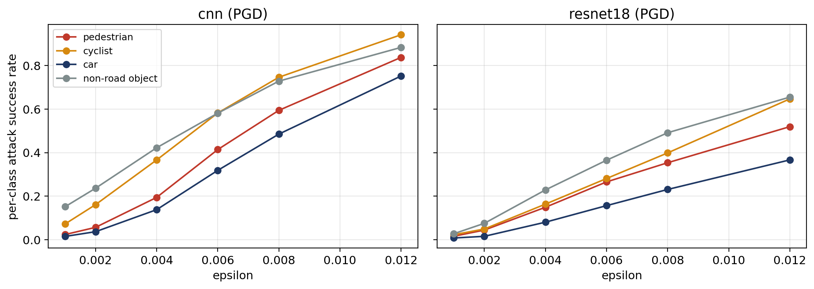

# RW-ASR: Risk-Weighted Attack Success Rate

<!-- TODO: 2-3 sentences in your own words: what this is and why it matters -->

$$\text{RW-ASR} = \frac{\sum_i w_i \cdot \mathbf{1}[\text{fail}_i]}{\sum_i w_i}, \qquad w_i = s(c_i)\,[P_{fatal}(v_{fail}) - P_{fatal}(v_{ok})]$$

## Results

| | Value |
|---|---|
| Clean accuracy | CNN 96.6%, ResNet-18 98.7% |
| Pedestrian vs car ASR | pedestrian higher in 18/18 conditions (1.1–2.0×) |
| RW-ASR vs flat ASR | higher in 18/18; mean +31%, mostly from zero-weight road-scene crops |
| Road users only | mean gap +2.0% (14/18 positive) |
| PGD vs random noise | 45% vs ~0.05% flip rate |




## Run it

1. Download the KITTI object labels and left color images from https://www.cvlibs.net/datasets/kitti/eval_object.php
2. Put `data_object_label_2.zip` and `data_object_image_2.zip` in `MyDrive/KITTI/` on Google Drive
3. Open `notebooks/RW_ASR_KITTI.ipynb` in Colab with a T4 GPU and run all

## Repo

```
notebooks/   main notebook
figures/     plots
results/     CSV outputs
```

## Limitations

<!-- TODO: your own words (no real speed data, assumed delay, crop classifier not a full detector, sequence leakage in split) -->

## Acknowledgments

Dr. Husain, Cal Poly Pomona (CalCyAIVR).

## AI assistance

<!-- TODO: edit to match what you actually did, e.g.: -->
Parts of the code were written with help from Claude (Anthropic). The project idea, metric design choices, and analysis are my own.

## References

- Geiger et al., "Are we ready for autonomous driving? The KITTI vision benchmark suite," CVPR 2012.
- Tefft, "Impact speed and a pedestrian's risk of severe injury or death," Accident Analysis & Prevention 50, 2013.
- NHTSA, Traffic Safety Facts 2023.
- Madry et al., "Towards deep learning models resistant to adversarial attacks," ICLR 2018.

KITTI data is CC BY-NC-SA 3.0 and is not included in this repo.
